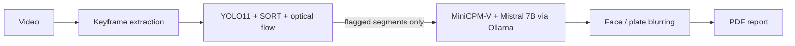

[+%40+MIT-WPU%2C+Pune)](https://git.io/typing-svg)

---

## 👋 About

I build GenAI applications that are **grounded, measurable, and often fully local**: RAG assistants, tool-calling agents, and vision-language pipelines in Python.
I'm a final-year B.Tech student (AI & Data Science) at MIT World Peace University, Pune, **open to fresher roles and internships in AI/GenAI engineering and data.**

---

## 🚀 Featured Projects

| Project | What it does | Highlights |
|---|---|---|
| 🤖 **[VeeraServe AI](https://github.com/Rishav408/VeeraServe)** | Agentic AI waiter for a restaurant: text, voice, and image input; adds to cart, places orders, checks status | LangGraph agent with **12 validated tools**, Chroma RAG, **6 evaluation suites**, **0% hallucinated prices** in measured runs, runs locally on LM Studio |
| ⚖️ **[Jurista](https://github.com/Rishav408/Jurista)** | Indian legal research copilot grounded in statutes, with document analysis | LangChain + Gemini, grounded in **4 legal texts** (BNS, IPC, CrPC, Constitution), dynamic search router, parses **PDF / DOCX / TXT** |
| 🚗 **[AI Dashcam Incident Explainer](https://github.com/Rishav408/Local-AI-Dashcam-Incident-Explainer)** | Fully offline incident detection and explanation from dashcam footage (team project, led) | YOLO11 + SORT + optical flow, MiniCPM-V and Mistral 7B via Ollama, **~80% fewer VLM calls**, face and plate blurring, PDF reports |
| 🗣️ **[Justify-AI](https://github.com/Rishav408/justify-ai)** | Explainable hate-speech analysis, no black-box transformers | **5 languages** (English, Hindi, Marathi, Bhojpuri, Marwari), Naive Bayes + lexical, causal, and demographic-bias scoring, FastAPI dashboard |

<b>🔍 How the Dashcam pipeline works</b>

Running the VLM only on flagged segments is what cuts inference calls by about 80%.

<b>More projects</b>

- 🩺 **[VaniCure](https://github.com/Rishav408/vanicure)**: offline-first respiratory audio screening (PANNs CNN14, YAMNet, CNN-BiLSTM ensemble; FastAPI + React)
- 📊 **[IndianPulse](https://github.com/Rishav408/india-economic-dashboard)**: interactive India economic dashboard, 11 indicators (Streamlit, Plotly, Pandas)
- 🏘️ **[Urban Hive](https://github.com/Rishav408/urbanhive-web)**: housing society platform with role-based dashboards (Node.js, MongoDB, JWT)
- 🧑‍💼 **[FaceMark](https://github.com/Rishav408/facemark)**: lightweight face-recognition attendance system (OpenCV, LBPH, Flask)

---

## 🧰 Tech Stack

**AI / GenAI**

**Backend, Data & Tools**

---

## 🎓 Certifications

- Anthropic: AI Fluency for Students; Claude Code in Action (2026)
- LangChain Academy: Introduction to LangChain, Python (2026)
- IBM SkillsBuild: Artificial Intelligence Fundamentals (2025)

---

## 📈 GitHub Activity

---

💬 *Open to AI / GenAI engineering, data, and full-stack internships and fresher roles. Reach me at* **[rishav4805@gmail.com](mailto:rishav4805@gmail.com)**

